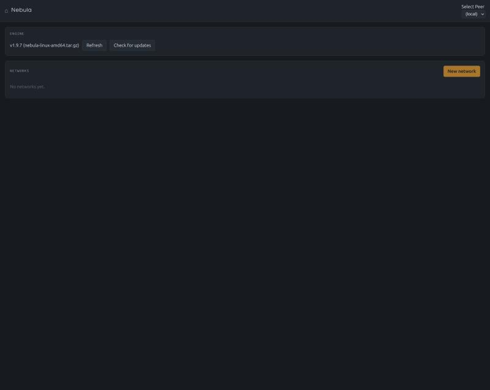

# Dev notes — working on the nebula app without touching live

**TL;DR.** Develop against the **scratch** instance
(`/home/gm/Desktop/newbound-scratch`, HTTP port 33182). Its Nebula library
and crate are symlinks into this worktree, so store edits made on scratch land
on the branch. Its `runtime/nebula` is its own real folder with its own
`networks/`, so nothing it does can reach the live `home` network.

Set up 2026-11-25 (Phase 0 of `NEBULA-APP-SPEC.md`).

## Layout after Phase 0

| Scratch path | What it is | How changes flow |
|---|---|---|
| `data/nebula` | symlink → `<worktree>/data/nebula` | `newbound exec dev code …` run in scratch writes straight into the worktree → `git diff` on the branch |
| `nebula` (crate) | symlink → `<worktree>/nebula` | `newbound rebuild` in scratch regenerates `nebula/src/` in the worktree; commit store + generated src together |
| `runtime/nebula/src` | symlink → `<worktree>/runtime/nebula/src` | the app shell HTML/JS/CSS, edited on the branch |
| `runtime/nebula/app.properties` | **copy** of the worktree file | the platform rewrites it; never commit it back |
| `runtime/nebula/bin/` | **copy** of live's engine (nebula v1.9.7, `nebula-cert`) | local only, gitignored |
| `runtime/nebula/networks/` | **empty, scratch-only** | test networks `t-*`, UDP ports 4250+ |
| `runtime/nebula/botd.properties` | absent | no network auto-starts on scratch boot |

Live is not linked anywhere: before Phase 0, scratch's `runtime/nebula` was a
symlink into the live runtime (`repositories/newbound_nebula/runtime/nebula`),
which holds the `home` network and its CA key.

## Recipe (to redo it from nothing)

Variables: `S=/home/gm/Desktop/newbound-scratch`,
`W=<this worktree>`, `L=/home/gm/Desktop/newbound` (live, read-only).

1. **Back up scratch** (it is disposable, but cheap to keep):
   `tar --exclude=newbound-scratch/target -czf newbound-scratch.bak-<date>.tgz newbound-scratch`
   (2026-11-25 backup: `/home/gm/Desktop/newbound-scratch.bak-2026-11-25-pre-nebula.tgz`).
2. **Bring scratch's platform up to live's flowlang.** The Nebula dylib pins
   `flowlang = "=0.3.47"`, and the hotswap loader refuses a dylib whose
   flowlang differs from the host's. Scratch was on 0.3.41, and Nebula was never
   installed there. So, in `$S`:
   - keep its `Cargo.toml` `exclude = […]` line (builder-written local state);
   - `rm -rf src newbound_core data/app data/dev data/peer data/security`;
   - `git -C $L archive <live HEAD> | tar -x -C $S` (read-only on live; 2026-11-25 used `518ca62f`);
   - put the `exclude` line back; in `cmd/Cargo.toml` set `flowlang = "=0.3.47"`;
   - `cargo build --release --features=serde_support`.
   `users/`, `config.properties`, `runtime/*` state and the peer identity are kept.
   (Scratch has its own peer uuid/keys, so it doesn't clash with live.)
3. **Wire Nebula to the worktree:**
   ```
   ln -s $W/data/nebula $S/data/nebula
   ln -s $W/nebula      $S/nebula
   rm $S/runtime/nebula                      # the symlink into LIVE
   mkdir -p $S/runtime/nebula/networks
   cp -a $L/repositories/newbound_nebula/runtime/nebula/bin $S/runtime/nebula/bin
   cp $W/runtime/nebula/app.properties $S/runtime/nebula/
   ln -s $W/runtime/nebula/src $S/runtime/nebula/src
   ```
   Add `nebula` to `apps=` in `$S/config.properties`.
4. **Generate and build:** in `$S`, `./target/release/newbound rebuild`
   (writes the gitignored `nebula/src/api.rs`; on 2026-11-25 it changed no
   tracked file). Then in `$W/nebula`:
   `cargo build --release --features=serde_support` → `nebula/target/release/libnebula.so`
   (gitignored). Scratch hot-loads it; after code changes, rebuild and it reloads.
5. **Start scratch:** `cd $S && ./target/release/newbound > boot.log 2>&1`.
   Expect `hotswap: loaded 'nebula' … (21 commands)` in `boot.log`.
   Check: `./target/release/newbound exec nebula nebula info '{}'` →
   `"networks":[]`, `"tag_name":"v1.9.7"`.
6. **Prove live is untouched** (read-only):
   `ip -br addr show dev home` → `192.168.100.1/24`; the live `newbound`
   (port 34241) and `nebula -config …/networks/home/config.yml` keep their PIDs and
   start times; file list + `sha256sum` of `networks/*/config.yml` unchanged.
   The 2026-11-25 before/after snapshots matched exactly (only the timestamp differed).
7. **Baseline screenshot:** log in to scratch, open `/nebula/index.html`:
   engine `v1.9.7`, "No networks yet." (live would list `home` and `oneshotnet`).
   

## Known side effects on scratch

- The agent overlay crates in scratch (`agent`, `kb`, `scratch`) were built
  against flowlang 0.3.41 and now fail to load (`ABI contract mismatch`).
  `newbound rebuild` bumped their pins to 0.3.47; they'd need a rebuild (and
  probably a newer overlay checkout) before the Agent app works on scratch
  again. Restore the backup above if you need the old scratch as it was.
- `hotswap: library 'nebula' predates the ABI contract symbol; loading
  unchecked`: the crate's `lib.rs` has no `nb_ffi_contract_nebula` export.
  Harmless today; it should be scaffolded the next time the crate is regenerated.

## Rules that still apply

- Never stop, restart or edit live (port 34241) or `runtime/nebula/networks/home/`.
- Never hand-edit `data/*`: use `newbound exec dev code <cmd> '<json>'` with
  `$S` as the working directory. The `newbound mcp` tools act on the live
  store, so don't use them for writes.
- Test networks: names `t-*`, UDP ports 4250+.
